# notes-web

**Notes** is a note-taking web app with private notes, public posts and an admin area. This repository is the browser client: a Next.js app that talks only to the REST API in the sibling repo [`notes-api`](https://github.com/hasinur1997/notes-api). The API owns all data, authentication and access rules; this app shows the data and sends what the user wants to do.

**Stack:** Next.js (App Router), React, Tailwind CSS and shadcn/ui (Base UI). There is no server-side data fetching, no API routes and no server actions: the browser holds the JWT and calls the API directly.

**At a glance**

- Anyone can read the public posts feed, a single post and a person's profile, without an account.
- Signed-in users keep private notes with a rich editor, share notes with other people, and publish public posts.
- Admins manage accounts, read any user's notes, and see users grouped by interest.
- Every list is paginated by the API. Pages switch smoothly, with a loading bar and cached data.

---

## Contents

- [Feature tour](#feature-tour)
- [Requirements](#requirements)
- [Development setup](#development-setup)
- [Scripts](#scripts)
- [Environment variables](#environment-variables)
- [Project structure](#project-structure)
- [How it works](#how-it-works)
- [Deployment](#deployment)
- [Troubleshooting](#troubleshooting)

---

## Feature tour

The screenshots below use demo data (sample people, notes and posts).

### Public posts

#### Posts feed

The home page (`/`) is open to everyone. It lists every public post, newest first, as cards with a cover image, the title, a short description and the author. **Read more** opens the full post, and more posts load automatically as you scroll. Visitors see **Sign up** and **Log in** at the top right; signed-in users see **My notes** and their account menu instead.

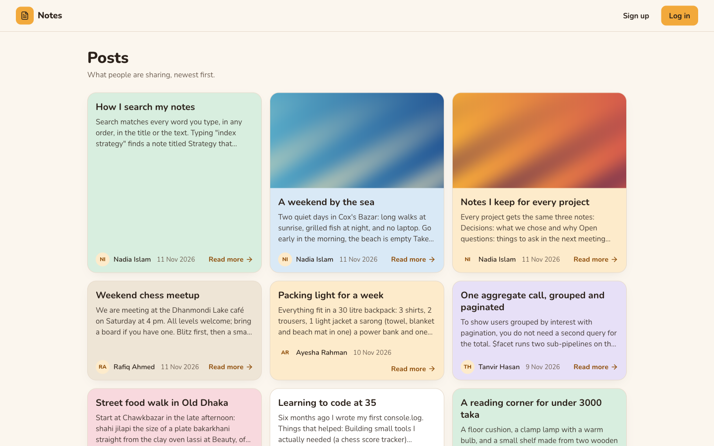

#### Reading a post

A post page (`/posts/[id]`) shows the whole post: its images, the title, the author and dates, and the formatted text (headings, lists, bold, italic and more). The author's name links to their profile.

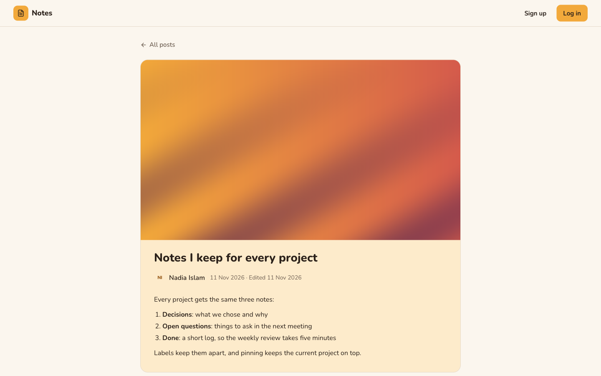

#### A person's profile and posts

`/users/[id]/posts` shows a person's public profile (name, photo, interests, join date and post count) and all of their posts. The API returns the profile and the posts together from a single aggregation pipeline (`$lookup` from users into posts). Email addresses are never shown publicly.

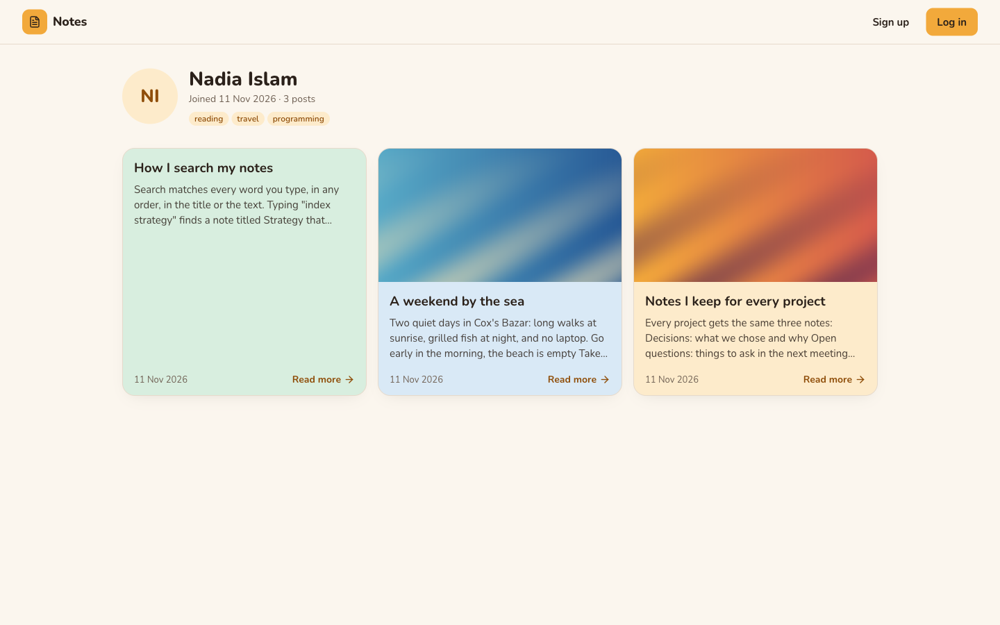

### Accounts

Create an account with a name, email and password, then sign in. Mistakes appear right under the field that needs fixing (invalid email, short password, passwords that do not match) instead of browser popups, and submitting moves the cursor to the first problem. Forgotten passwords can be reset with an emailed link.

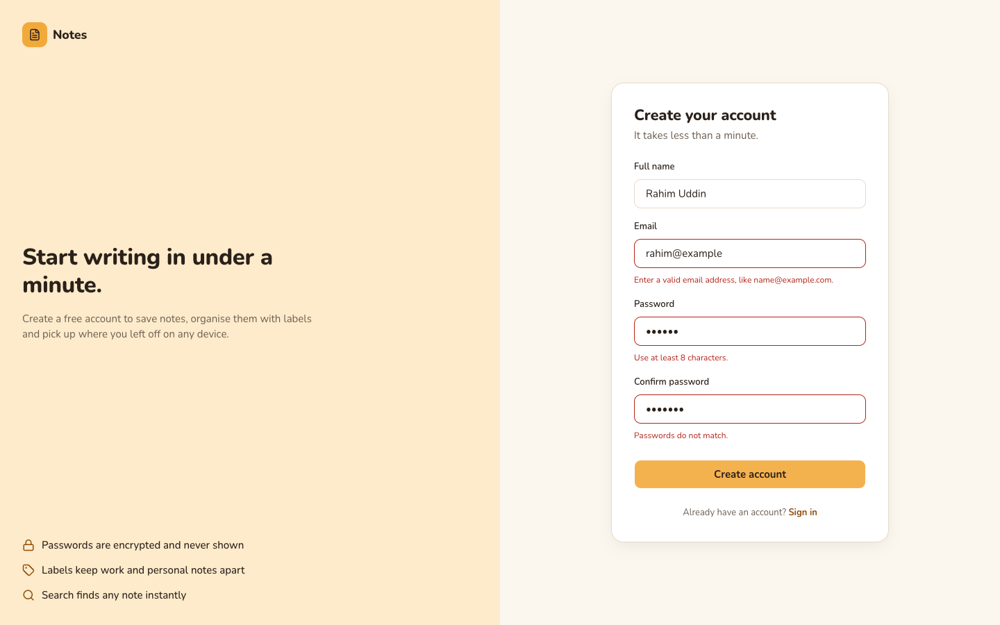

### Notes

#### Your notes

After signing in you land on your notes. A note can have a title, formatted text, a colour, labels, a reminder, images and collaborators. Pinned notes stay on top. The sidebar shows how many notes you have, your reminders, your posts and every label with its count; choosing a label filters the list. The search box at the top matches every word you type, in any order, in the title or text. Notes shared with you by other people appear here too, with their avatars on the card.

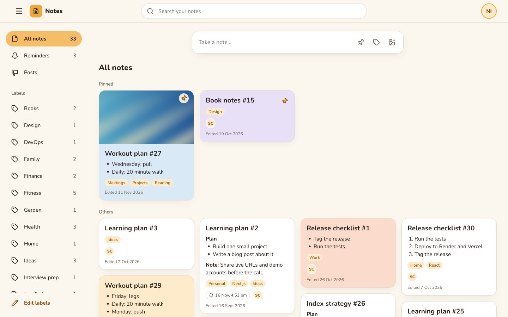

#### The note editor

Click a note to edit it. The editor supports Markdown formatting from a toolbar (or keyboard shortcuts), colours, reminders, labels, collaborators, up to five images (added with the button, by drag and drop, or by pasting, and croppable), and undo / redo. Changes save when you close the editor. Notes are private: only the owner and the people they share a note with can see it.

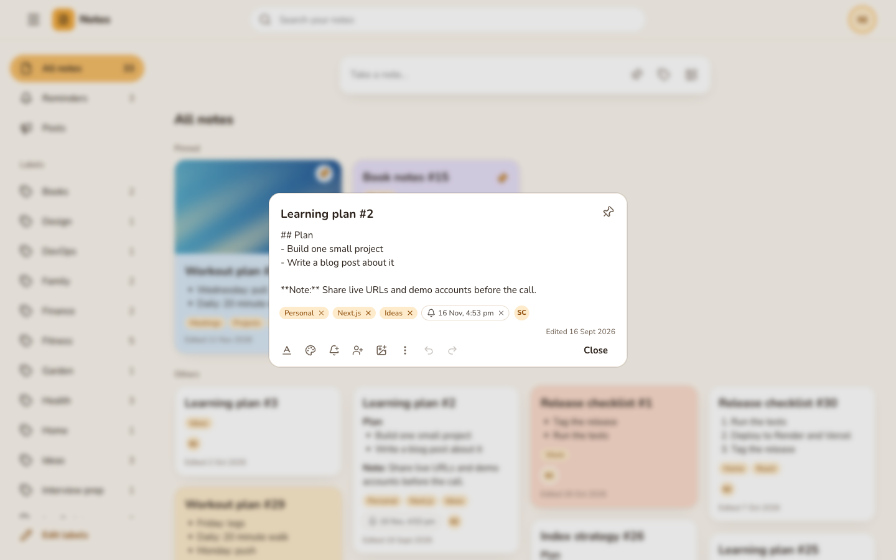

### My posts

**Posts** in the sidebar is where you write and manage your public posts. Posts use the same editor as notes (text, formatting, colour and images). Your posts open right here when you click **Read more**, and the pencil opens them for editing. **View my public page** shows your profile as everyone else sees it.

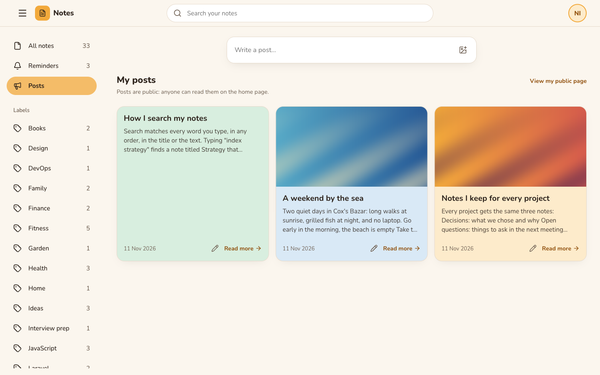

### Profile and settings

The profile page lets you change your name, add a photo (with cropping) and list your interests. Settings let you choose how long note lists behave: page numbers or infinite scroll, and 12, 24 or 48 notes per page. Settings are saved to your account, so they follow you to any device.

| Profile | Settings |
|---|---|
| 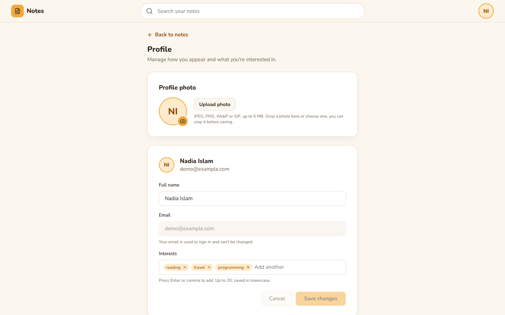 | 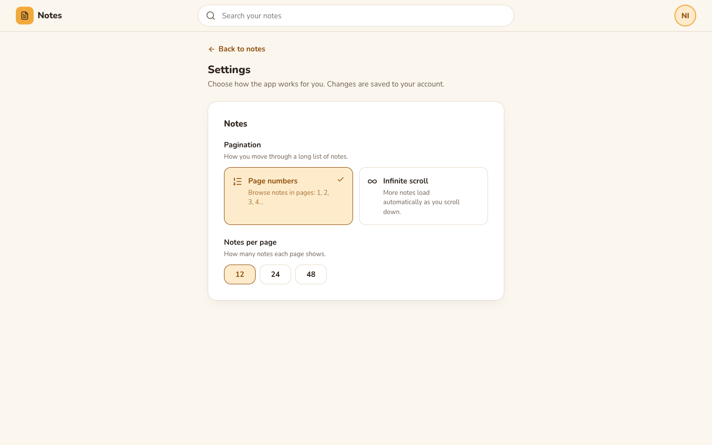 |

### Administration

Admins see three extra menus in the sidebar. The interface only hides what a user cannot do; the API checks the role on every request.

#### Users

Every account in a paginated table with search by name or email. Admins can create users, edit their details or password, change roles from the list, and delete accounts (which also removes that person's notes and posts). Admins cannot delete or demote themselves, so there is always at least one admin.

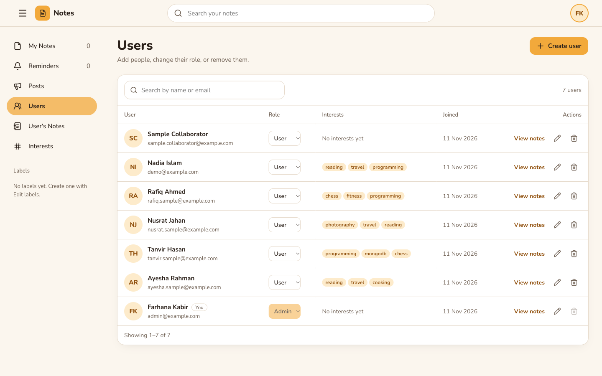

#### User's Notes

Pick a person to read their notes exactly as they see them (their own notes and notes shared with them). This view is read-only.

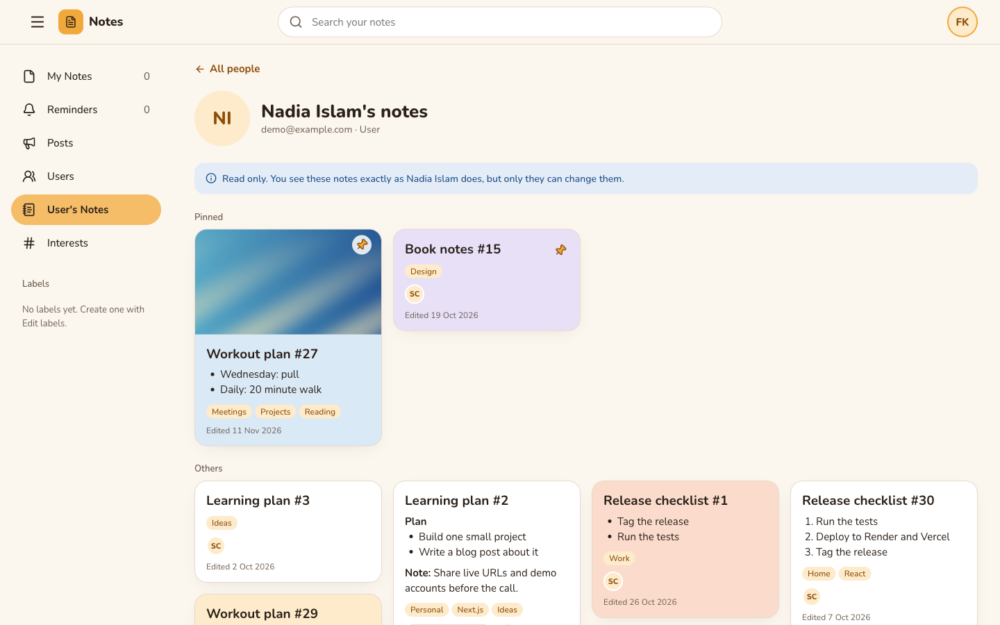

#### Interests

Users grouped by the interests on their profiles, largest group first, with a filter for a single interest. The API builds this with one aggregation pipeline (`$unwind` and `$group`, paginated with `$facet`), backed by the index on `interests`.

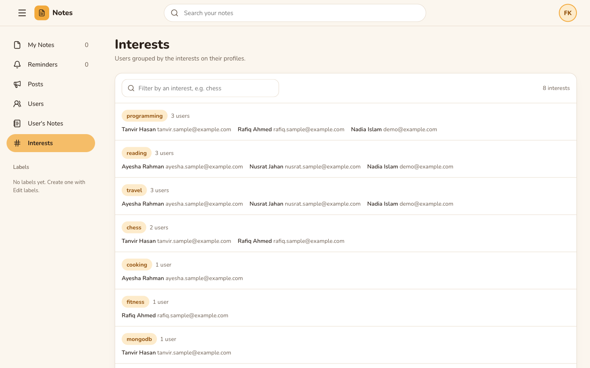

---

## Requirements

| Tool | Version |
|---|---|
| Node.js | 20.12 or newer (24 LTS recommended; CI uses 24) |
| notes-api | Running locally or deployed (see its README) |

---

## Development setup

```bash
git clone https://github.com/hasinur1997/notes-web.git
cd notes-web
npm install
cp .env.example .env.local
```

Point the app at the API in `.env.local`:

```dotenv
NEXT_PUBLIC_API_URL=http://localhost:5000/api
```

> **macOS:** AirPlay Receiver uses port 5000, so the API usually runs on `5001`. Use `http://localhost:5001/api`.

The API must allow this app's origin: keep `CORS_ORIGIN=http://localhost:3000` in the API's `.env`.

Start the app:

```bash
npm run dev     # http://localhost:3000
```

To sign in as an admin, create the admin in the API (`npm run seed` there). To fill the public feed, run `npm run seed -- --sample-posts` in the API.

> In development, Next.js compiles each page the first time you open it, so the first visit to a page can take a moment. Production builds are fast from the start.

## Scripts

| Command | What it does |
|---|---|
| `npm run dev` | Development server with hot reload |
| `npm run build` | Production build (must pass before every deploy) |
| `npm start` | Serves the production build |
| `npm run lint` | ESLint |

## Environment variables

| Variable | Required | Description |
|---|---|---|
| `NEXT_PUBLIC_API_URL` | ✅ | API base URL including `/api`. It is built into the browser code, so set it **before** `npm run build` |

Only `.env.example` is committed. Never put secrets in `NEXT_PUBLIC_*` variables: they are visible in the browser.

---

## Project structure

```
src/
├── app/                 pages (App Router): /, /login, /register, /notes, /posts, /posts/[id],
│                        /users/[id]/posts, /profile, /settings, /admin/{users,user-notes,interests}
├── components/
│   ├── ui/              shadcn components (added with the CLI)
│   ├── layout/          AppShell (header + sidebar), PublicShell, SidebarPage, NavigationProgress, UserMenu
│   ├── notes/           notes screen, cards, grid, composer, shared editor
│   ├── posts/           feed, post page, a user's posts, My posts, post editor and viewer
│   ├── admin/           users, user's notes, interests
│   └── auth/ profile/ settings/ crop/
├── context/AuthContext.jsx   who is signed in
├── hooks/               useApiQuery, useInfiniteList, useFieldErrors, ...
└── lib/                 api.js (the only module that calls the API), queryCache, validation, markdown, ...
```

## How it works

- **API calls** go only through `src/lib/api.js`, which adds the `Authorization: Bearer` header, turns errors into messages for toasts, and signs the user out on a `401`.
- **Auth state** lives in `AuthContext`. The token is kept in `localStorage` and read only inside effects, so server and client renders match. Route guards are for the UI only; the API decides what each user may do.
- **Smooth navigation:** pages keep their header and sidebar steady, a thin bar at the top shows a page is loading, and API responses are cached for the session (`lib/queryCache.js`). Going back to a page shows its data at once and refreshes it in the background. The cache is cleared whenever the signed-in account changes.
- **Forms** show errors under each field instead of browser popups (`lib/validation.js`, `hooks/useFieldErrors.js`). These checks give quick feedback; the API validates everything again.
- **Markdown** is rendered by `lib/markdown.jsx` into React elements only (no HTML strings), so note and post text can never inject markup.

---

## Deployment

Production runs on cPanel (Phusion Passenger) and is deployed by GitHub Actions (`.github/workflows/deploy.yml`) on every push to `main`:

1. **Build** on GitHub: `npm ci`, `npm run lint` and `npm run build` with `NEXT_PUBLIC_API_URL` from the `production` environment's variables. Shared hosting has too little memory to build there.
2. **Deploy:** only what the server runs (the built `.next` without its build cache, `package.json`, `package-lock.json`, `next.config.mjs` and `server.js`) is sent over SSH; source code, docs and screenshots never reach the server. Dependencies are installed with `npm install --omit=dev`, and Passenger restarts. Passenger starts the app through `server.js`.

**One-time setup:** create the app in cPanel **Setup Node.js App** (startup file `server.js`). On GitHub, in **Settings → Environments → `production`**, add the variable `NEXT_PUBLIC_API_URL` and the secrets `CPANEL_SSH_KEY`, `CPANEL_KNOWN_HOSTS`, `CPANEL_HOST`, `CPANEL_PORT`, `CPANEL_USERNAME` and `CPANEL_DEPLOY_PATH`.

## Troubleshooting

| Problem | Fix |
|---|---|
| "The app is not configured: NEXT_PUBLIC_API_URL is missing." | Set it in `.env.local` and restart `npm run dev` (or rebuild) |
| "Cannot reach the server" | Start the API, and check the port in `NEXT_PUBLIC_API_URL` |
| CORS errors in the browser console | Add this app's exact origin to `CORS_ORIGIN` in the API |
| Images do not show | Images stored on the API server are served from its `/uploads`; check that the API is reachable from the browser |
